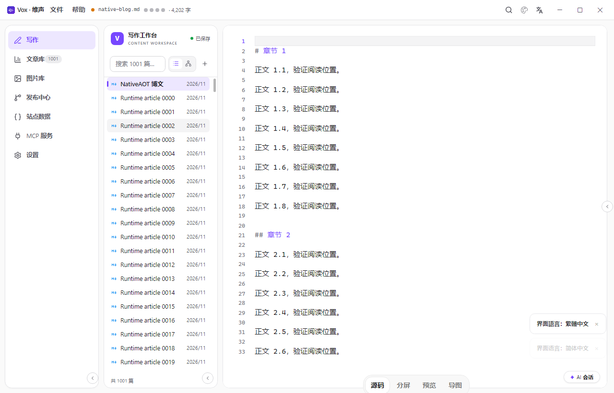
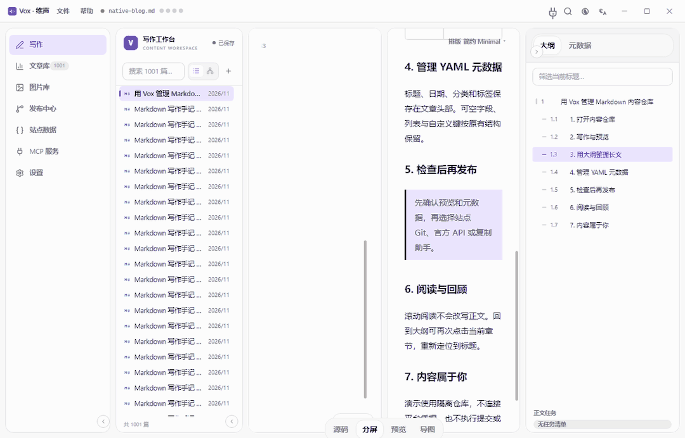
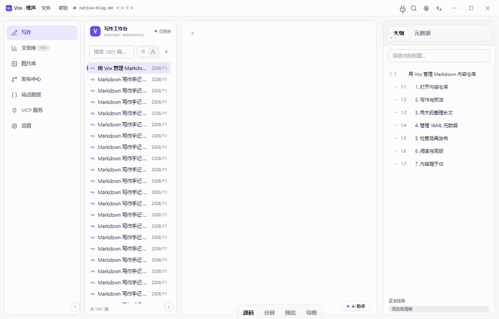
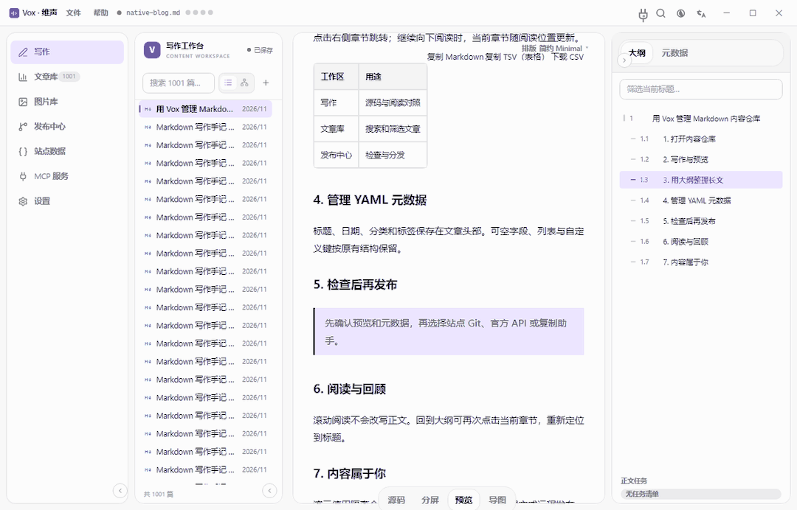
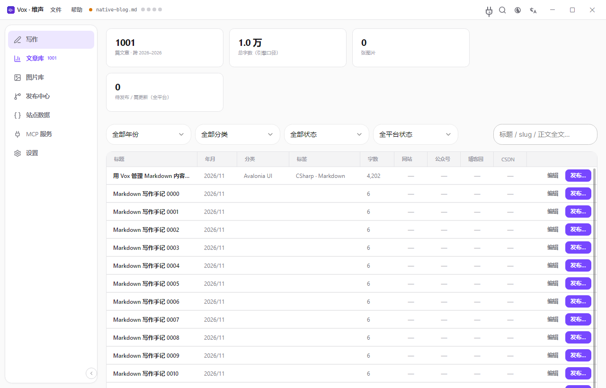
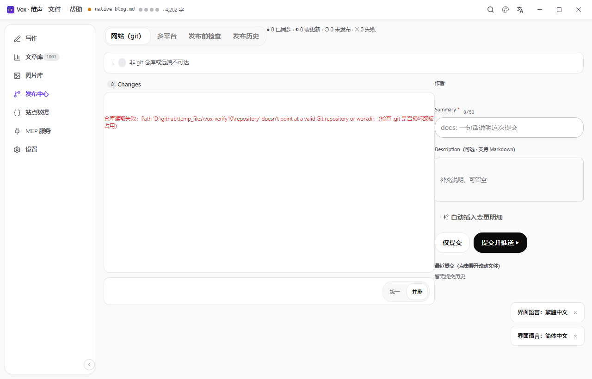
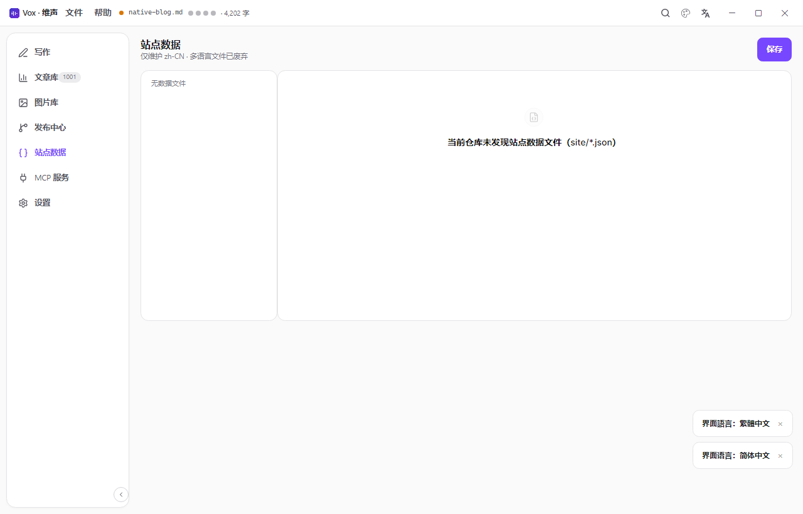
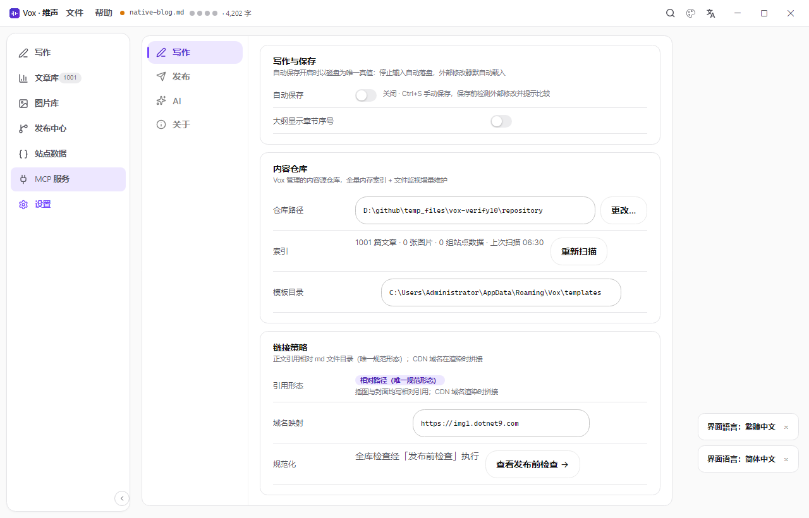

<div align="center"></div>

# Vox · 维声

一处落笔，处处有声。

Vox 是基于 .NET 与 Avalonia 的桌面**写作环境、内容仓库治理与多平台分发工作台**，第一目标是服务自建站点 [CodeWF](https://codewf.com) 的内容源仓库 [Assets.Dotnet9](https://github.com/dotnet9/Assets.Dotnet9)：写作、文章/图片管理、站点数据、Git 同步、多平台发布与状态追踪在一个应用内闭环。

作者：沙漠尽头的狼 · 出品：[码坊 CodeWF](https://codewf.com) · 姊妹产品：[Vex · 维刻](https://github.com/dotnet9/Vex)（独立维护）· 当前版本：**0.2.0-preview.6**

> 代码不是护城河，闭环才是。

## 为什么做 Vox

"我直接用 VS Code 打开内容仓库就能改所有文件，为什么要用 Vox？"——因为 **VS Code 看到的是文件，Vox 看到的是文章、图片与分发状态**：

1. **写作工作区**：Markdown 源码、实时预览、思维导图、元数据与自动保存协同。
2. **仓库语义视图**：文章库按标题、日期、分类、专辑、标签与平台状态组织内容。
3. **图片资产管理**：导入、缩略图、引用关系、封面与孤儿图治理。
4. **发布闭环**：Git 网站发布、多平台 API/复制助手、发布检查、历史与更新线索。
5. **自动化入口**：MCP 服务让受控 AI 客户端按权限读取和维护内容。

## 当前产品基线

当前为桌面预览版，已有真实的七工作区实现。下面的 PNG / GIF 采集于 2026-11-08 本地验收构建（采集时版本元数据为 0.2.0-preview.2）；所示阅读大纲修复纳入 0.2.0-preview.3，安装包及发布状态以对应 GitHub Release 为准。界面使用隔离演示仓库，不连接平台凭据，也不执行远程发布。



### 文章列表与树形

参照 Vex 的单行导航与选中样式，列表和年 / 月树共用虚拟化宿主。左右方向键折叠、展开目录，切换视图保留当前文章。



### 同一文章的四种视图

源码、分屏、预览、思维导图共享当前文章；右侧可切换大纲和元数据。



### 大纲定位与阅读跟随

大纲已按 Vex 的层级角标、章节编号与单行标题组织，并使用虚拟化 ListBox。支持标题筛选（保留父级上下文）、左右键折叠展开、点击或 Enter / Space 显式定位；已选节点可以重复激活。阅读预览滚动更新当前章节高亮，不改变正文或抢占焦点。



| 文章库 | 发布中心 |
| --- | --- |
|  |  |

| 站点数据 | 设置 |
| --- | --- |
|  |  |

采集流程、演示数据与验证边界见[当前操作手册](docs/软件操作手册.md)。设计参考仍在 [design/Vox.html](design/Vox.html)，不作为功能已经实现的证据。

当前主窗口冻结为七个导航工作区：

- **写作**：文章列表 + 源码/分屏/预览/思维导图 + 元数据/大纲/图片面板。
- **文章库**：统计、筛选、搜索、平台状态与分页。
- **图片库**：图片筛选、缩略图墙、引用详情与孤儿图清理。
- **发布中心**：网站 Git 工作区、多平台矩阵、发布前检查、发布历史。
- **站点数据**：维护 `site/*.json`。
- **MCP 服务**：服务配置、客户端、工具目录、调用审计。
- **设置**：仓库、保存、链接策略、凭据、平台、LLM、外观（Arc / Pixel、密度、明暗、动效与强调色）等。

真实应用从所选仓库读取文章与本地状态。上述媒体使用专门生成的演示仓库；1001 篇文章用于验证虚拟化和滚动回收，不代表用户仓库的实际数据规模。平台发布成功需以真实服务返回及结果核验为准。

## 接下来优先完善

1. **发布可靠性**：平台适配器、远程文章 ID/URL、更新能力、发布结果核验与失败重试。
2. **发布状态闭环**：持久化任务与快照，源文章变化后准确标记“需更新”。
3. **跨平台复制助手**：平台渲染画像、HTML/富文本打包、剪贴板格式与字段复制。
4. **质量与交付**：补齐自动化测试、打包/升级验证与 Windows/macOS/Linux 实机体验。
5. **通用化**：在第二种真实仓库验证后，再抽象仓库画像接口。

## 目标平台与接入策略

接入能力分三级：**官方 API**、**实验性非官方接口**、**复制助手**。优先选择可维护、可验证的官方通道；非官方接口必须明确标注风险，并提供复制助手兜底。

| 平台 | 接入方式 | 当前定位 |
| --- | --- | --- |
| 博客园 | MetaWeblog | 已有适配，持续验证 |
| CSDN | 编辑器内部接口（Cookie + HMAC） | 实验性，非官方，可能随平台变更失效 |
| 微信公众号 | 官方草稿/发布 API | 持续完善 |
| 知乎 | 复制助手 | 无公开发布 API 时不模拟官方接口 |
| 掘金、今日头条、B 站专栏等 | 评估官方能力；否则复制助手 | 后续评估 |
| GitHub / Gitee | git 同步 Markdown 镜像 | 后续评估 |

## 技术栈

.NET 11 RC · Avalonia 12.1.5 · [TKCode.Arc](https://www.nuget.org/packages/TKCode.Arc)（官方 NuGet 组件、独立主题、强调色与弹簧动效）· [CodeWF.Avalonia.Markdown](https://github.com/dotnet9/CodeWF.Avalonia)（Markdown 实时预览与排版内核）· LibGit2Sharp（内置 git）· CommunityToolkit.Mvvm · AvaloniaEdit（与 Vex 使用同一编辑器）。

SDK 固定在 `global.json`，目标框架与编译默认值在 `build/ProjectDefaults.props`，NuGet 版本变量在 `build/Versions.props`，`Directory.Packages.props` 只维护中央包声明。主分支跟随稳定／预览依赖，不以 Win7 为兼容目标；升级前代码冻结在 `win7-archive`。当前使用官方 NuGet Arc **0.4.0-preview.5**、CodeWF.Avalonia **12.1.5.2**、Toolkit **1.1.6**。Arc 仍精确依赖 Avalonia 12.1.4，采用 12.1.5 时保留 `NU1608` 警告，并以本机与 CI 验证覆盖兼容性。启用 nullable 与 C# preview，可空诊断作为构建错误。

默认从正式 NuGet 还原，无需重建候选自研库：

```powershell
$work = 'D:/github/temp_files/vox-dev'
dotnet build Vox.slnx -c Release "-p:ArtifactsPath=$work/artifacts"
dotnet test Vox.slnx -c Release --no-build "-p:ArtifactsPath=$work/artifacts"
dotnet run --project src/Vox.App -c Release --no-build "-p:ArtifactsPath=$work/artifacts"
```

跨平台：目标 **win-x64、linux-x64、linux-arm64、osx-x64、osx-arm64** 五个 RID。正式发布与本机验证共用 NativeAOT 配方，每个平台同时提供安装包、便携压缩包及 SHA256：

| 系统 | 安装包 | 便携压缩包 |
| --- | --- | --- |
| Windows x64 | EXE | ZIP |
| Linux x64 / arm64 | DEB | tar.gz |
| macOS x64 / arm64 | DMG | ZIP（包含带图标的 `Vox.app`） |

版本和资产以 [GitHub Releases](https://github.com/dotnet9/Vox/releases) 为准，预览版本请在发布列表中选择。Windows 安装会创建开始菜单入口，桌面快捷方式与 Markdown 打开候选按所选选项生成。macOS 使用 ad-hoc 签名，未宣称 Developer ID 签名或公证完成。制作方式、原生验证与安装回归见[安装与发布](docs/安装与发布.md)。

2026-11-08 两种构建验证已通过：JIT 实际窗口覆盖四语言、七页、明暗主题、1001 篇文章虚拟化和树键盘操作；win-x64 NativeAOT 发布产物运行退出码 0，YAML / nullable 往返、大纲导航与阅读跟随均通过。其他平台的人工体验与外部平台真实发布仍需独立验收。

应用外观由 Arc 管理；Markdown、思维导图、表格和国际化复用 CodeWF.Avalonia，产品不覆盖这些库的控件模板。

## 文档

- [产品需求基线](docs/需求.md) —— 功能范围、用户工作流、非目标、开放问题
- [架构与技术选型](docs/架构.md) —— 解决方案结构、依赖锁版、git 分层、链接策略
- [信息架构](docs/信息架构.md) —— 页面结构与旧原型处置
- [软件操作手册](docs/软件操作手册.md) —— 当前应用操作、真实 PNG / GIF 与采集流程
- [安装与发布](docs/安装与发布.md) —— 五平台 NativeAOT、安装包和便携包、SHA256 与安装回归
- [历史原型操作手册](docs/原型操作手册.md) —— 早期设计参考，不代表当前功能状态
- [决策记录](docs/决策记录.md) —— 为什么这么定（ADR-lite）
- [Assets.Dotnet9 体检基线](docs/Assets.Dotnet9体检基线.md) —— 2026-10-23 存量快照，体检规则的验收基准
- [技术验证清单](docs/技术验证Spike.md) —— 动工前必须跑通的 4 个 spike
- [设计原型](design/Vox.html) —— 旧版（Vex 风格），仅信息架构参考，视觉由 Arc 主题接管

## 安全与隐私

- 平台凭据（PAT、平台 token、登录 Cookie）只保存在本机系统凭据管理器，不进入仓库、不上传任何服务器
- git 操作与发布动作由本机直接发起，无中间服务
- 非官方接口仅用于发布本人原创内容，保持低频，避免触发平台风控

## 相关产品

- [Vex · 维刻](https://github.com/dotnet9/Vex)：跨平台 Markdown 编辑器，通用离线文档编辑，与 Vox 独立维护
- [CodeWF](https://codewf.com)：前后端分离的 Markdown 博客站点
- [Assets.Dotnet9](https://github.com/dotnet9/Assets.Dotnet9)：站点内容源仓库，Vox 的首要服务对象

## 许可证

[MIT](LICENSE) © 沙漠尽头的狼(codewf.com)
