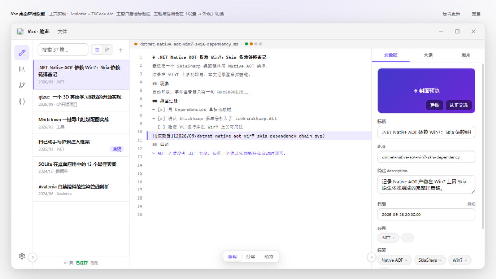
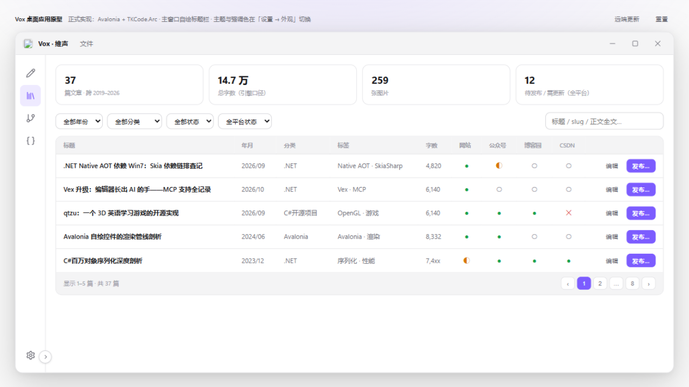
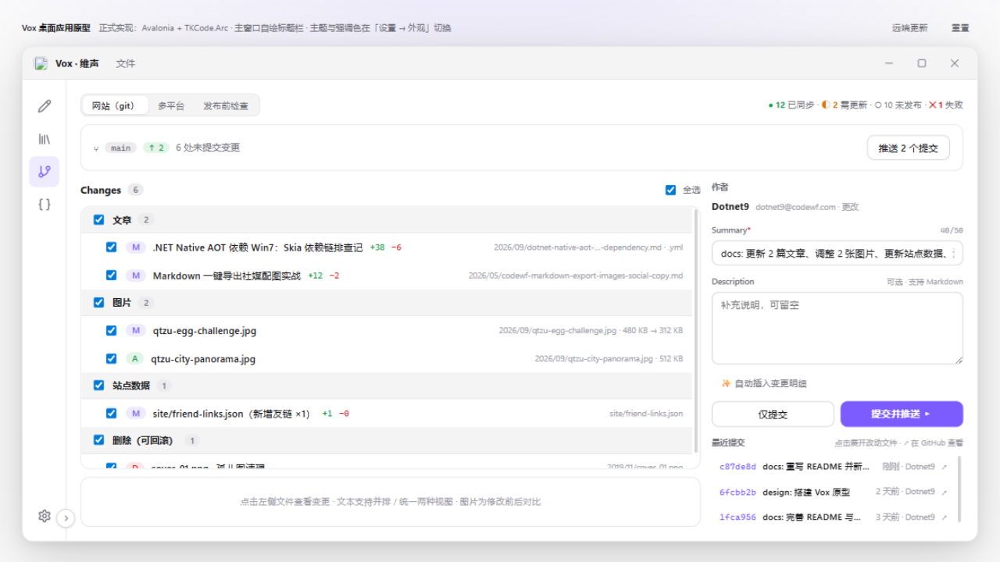
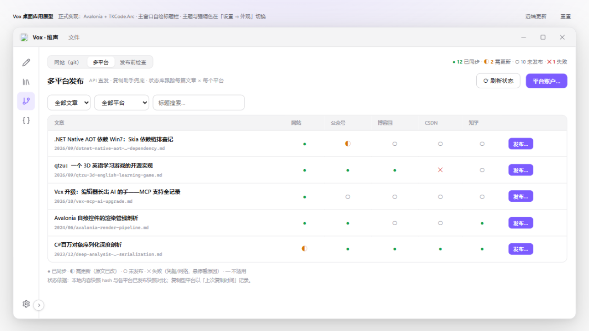
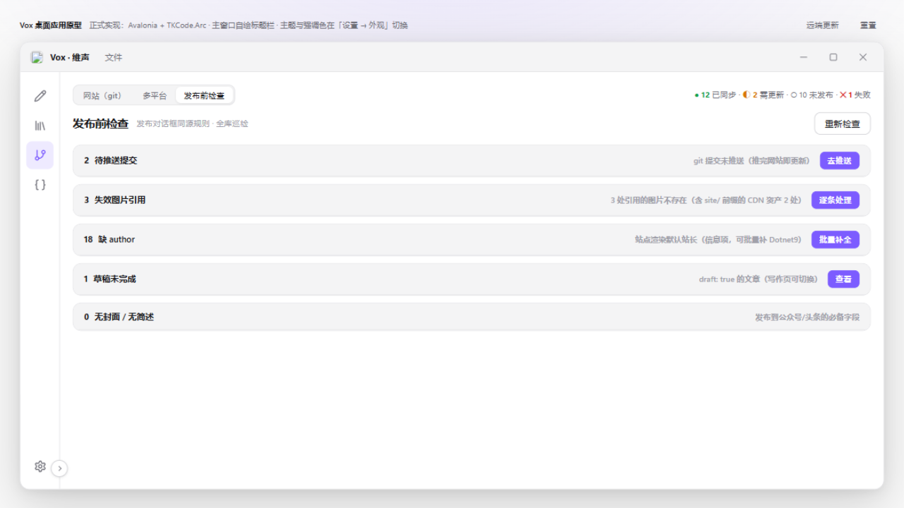
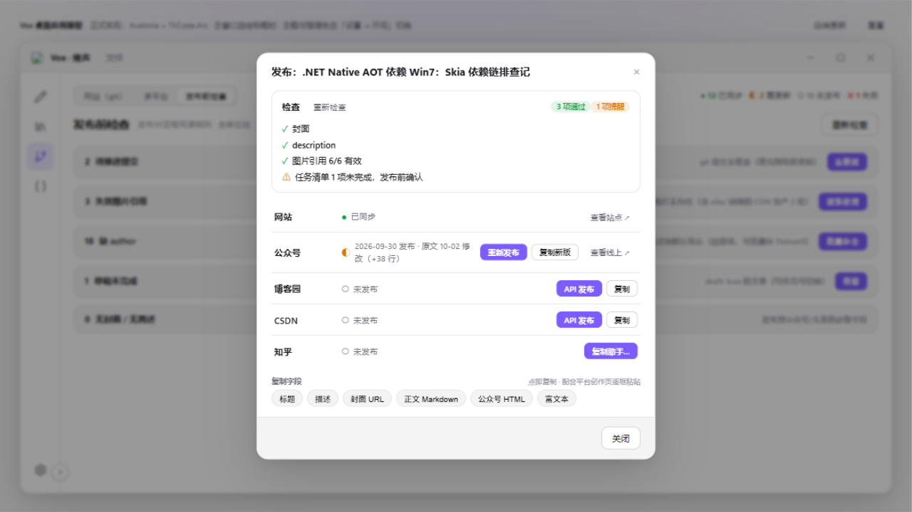
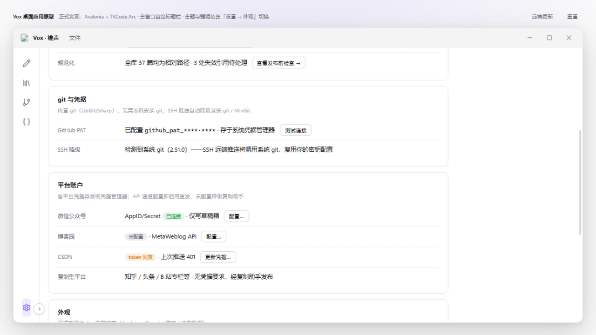

# Vox 软件操作手册（M1 原型版）

对应原型：[design/Vox软件原型.html](../design/Vox软件原型.html)（直接双击打开即可体验，本文截图均取自该原型）。本手册描述 M1 目标交互，是后续 Avalonia 实现的验收基准；界面视觉由 TKCode.Arc 主题正式接管，交互以本文为准。

> 2026-10-25 更新：资源仓库治理已完成（536 → 37 篇，图片相对路径化、front matter 内联化），软件重心转为**日常文章维护 + 多平台发布**。信息架构由七视图收敛为五视图（删除图片库 / 体检，同步并入发布中心）。

## 1. 安装与启动

三平台均从 GitHub Releases 下载，安装体验遵循各平台惯例：

| 平台 | 安装方式 | 卸载方式 |
| --- | --- | --- |
| Windows | 品牌安装向导：欢迎 → 许可证 → 位置 → 组件 → 安装 → 完成 | 「设置 → 应用」或开始菜单程序组 → 卸载向导（可选保留用户数据） |
| macOS | 标准 DMG：把 Vox 拖入 Applications | 把 Vox 拖入废纸篓（残留清理命令见卸载页说明） |
| Linux | 软件中心（.deb/.rpm）或命令行 / AppImage | 软件中心「移除」或 `apt/dnf remove` |

完成页勾选「立即启动 Vox」后，点击右下按钮即进入软件（原型中会打开软件原型页——整条链路是串起来的）。

## 2. 主界面总览

- **标题栏**：左侧为软件 **Logo + 名称「Vox · 维声」+「文件」菜单**（新建文章 / 文章元数据… / 图片入库…）；右侧仅 Windows 式窗口控制钮。不显示视图名、文件名、搜索框与新建按钮——新建入口在文章列表头「＋」。
- **左边栏**：五个内容视图入口——**写作 / 文章库 / 发布中心 / 站点数据 / 设置**（图标来自 Lucide 体系，正式实现用 `LucideIcon` / `ArcIcons`）；发布中心带待处理角标；**设置固定在边栏底部**，其下为当前仓库卡片、主题与强调色切换。
- **边栏折叠**：默认收起为纯图标条；折叠钮是**骑在左边框上、与「设置」对齐的圆形小钮**（展开态 ‹ / 折叠态 ›）。
- **内容区默认源码模式**；「源码 / 分屏 / 预览」浮动切换钮**悬于内容区底部居中**；**文件名小栏横跨源码/预览/大纲三区顶部恒定显示**，文件名右侧是**发布状态徽标**（四个彩点对应 网站/公众号/博客园/CSDN，点开即发布对话框）。右侧文章面板默认收起；展开后为**元数据 / 大纲 / 图片三页签**，折叠钮骑在右分隔线上与左侧同高。
- **国际化**：支持界面语言切换（设置 → 外观 → 语言 / Language），主题、强调色、动效同样收拢在设置内外观段（边栏底部不再放置切换入口）。

## 3. 写作（默认视图）

三区布局：**文章列表 ｜ 编辑器 / 预览 ｜ 文章面板**，两侧均可在正式实现中收起。

### 3.1 文章列表：列表 / 树形

- 列表头右侧：**列表视图**（平铺）↔ **树形视图**（年 → 月 → 文章两层，可折叠）切换 + 「＋」新建按钮。
- **点击任一文章即切换编辑内容**：源码、预览、文章面板、标题栏文件名与发布徽标全部联动。

### 3.2 编辑器与预览

- 编辑器带**行号、当前行高亮、文件名小栏**（正式实现 = AvaloniaEdit + TextMate，与预览同源高亮）。
- 「源码 / 分屏 / 预览」三态经内容区底部浮动钮切换；提交推送与各平台发布在「发布中心」视图操作。
- 预览由 StreamMark 渲染：标题、任务清单、代码块、图片（相对路径本地解析）。
- 文件名小栏右侧**发布状态徽标**：四个彩点（绿=已同步 / 黄=需更新 / 灰=未发布 / 红=失败，含知乎时第五点），悬停看各平台明细，点击打开发布对话框。

### 3.3 新建文章向导

标题 → slug/日期自动生成（可改，实时预览落位路径）→ 简述 → 大纲骨架（生成 md 标题脚手架）→ 确认页展示将创建的 md（front matter 内联在文件头，无独立 yml）→ 「创建并打开」直接进入写作页。

### 3.4 图片入库

拖入 / 点击选择 / Ctrl+V 粘贴 / 网图 URL 下载四种来源；自动按 slug 前缀命名并落入文章年月目录；插入形态为**相对 md 文件所在目录的路径**（唯一规范形态，渲染时拼 CDN 域名）；可勾选「同时设为文章封面」。

### 3.5 文章面板（三页签）

- **元数据**：封面预览（「更换 / 从正文选」）；title/slug/简述/日期表单化编辑；分类、标签为 chips；作者 + 草稿开关。字段即文件头内联 front matter。
- **大纲**：预览大纲（点击滚动源码到对应行居中）+ 正文任务清单进度。
- **图片**：本篇图片缩略图网格 + 拖入/粘贴入库（与「文件 → 图片入库」同一管线）+ 引用形态说明。
- 「文件 → 文章元数据…」= 展开面板并切到元数据页签（无独立对话框）。

## 4. 文章库

- 顶部统计条：文章数 / 总字数 / 图片数 / 待推送（对齐治理后 37 篇口径）。
- 筛选：年份、分类、状态（已发布 / 草稿）下拉 + 快捷徽标 + 全文搜索。
- 表格列：标题、年月、分类、标签、字数 + **网站 / 公众号 / 博客园 / CSDN 平台状态列**（● 已同步 / ◐ 需更新 / ○ 未发布 / ✕ 失败，悬停看快照说明）；行尾「编辑」进入写作页，「发布…」打开发布对话框。
- 双击行进入写作页编辑态（同窗切换，不开新窗口）。

## 5. 发布中心

发布中心承接原「同步」视图并扩展为三标签：**网站（git）｜多平台｜发布前检查**。

### 5.1 网站（git）

两栏布局（GitHub Desktop 心智模型）：左侧 **Changes 勾选暂存 + diff 预览**，右侧 **Summary / Description 提交面板**。git push 即完成网站发布（站点直接读仓库，CDN 域名渲染时拼接）。

- **分支条**：main · ↑ 领先 / ↓ 落后徽标 + 「拉取」（ff-only 快进）；「推送 N 个提交」仅在有未推送提交时出现；落后（↓1）时推送被拒绝，须先拉取。原型页顶部工具条提供「远端更新 / 重置」控制评审状态（非应用界面）。
- **Changes 列表**：按语义分组（文章 / 图片 / 站点数据 / 删除·可回滚），组头可折叠并全选；每行**勾选暂存**，支持只提交一部分；行内显示 +/− 行数与路径；全选框在列表头。**右键文件行出上下文菜单（对齐 GitHub Desktop）**：放弃更改…（确认后还原该文件，新增文件删除）、忽略此文件 / 忽略所有 .{ext} 文件（加入 .gitignore）、复制文件路径 / 相对路径、在资源管理器中显示、在 VS Code 中打开、用默认程序打开（后三项对已删除文件置灰）。
- **diff 预览**：点击文件行查看变更；右上角 **并排 / 统一** 两种视图切换（并排 = 左旧右新双栏，统一 = 行内 +绿 −红）；**图片为修改前 → 修改后左右对比**（新增文件一侧显示"无旧版"虚线占位，删除则右侧虚线占位），附尺寸与体积说明。
- **提交面板**：作者身份（可更改）；**Summary** 必填单行，自动生成建议（`docs: 更新 2 篇文章、调整 2 张图片…`），50 字符软上限超限变黄；**Description** 可选多行，「✨ 自动插入变更明细」按勾选项生成 bullet 列表；**仅提交**（离线攒提交）与**提交并推送**（主按钮）双动作。
- **历史**：点击条目展开该次提交的改动文件列表；↗ 在 GitHub 查看提交页。
- 全部提交后进入「一切已同步」空状态（可用页面顶部工具条「重置」恢复演示数据）。

### 5.2 多平台

**文章 × 平台状态矩阵**：每行一篇文章（标题 + 落位路径），每列一个平台（网站 / 公众号 / 博客园 / CSDN / 知乎），单元格为状态符号：

| 符号 | 状态 | 含义 |
| --- | --- | --- |
| ● 绿 | 已同步 | 平台已发布快照 = 本地内容快照（hash 一致） |
| ◐ 黄 | 需更新 | 发布后原文又改过（如「原文 10-02 修改 +38 行」） |
| ○ 灰 | 未发布 | 该平台从未发布 |
| ✕ 红 | 失败 | 上次发布出错（如凭据失效 401），附原因与重试 |

- 汇总条统计全矩阵（如 `● 12 已同步 · ◐ 2 需更新 · ○ 10 未发布 · ✕ 1 失败`）；矩阵底部有图例。
- 点击任一状态点或行尾「发布…」→ 打开**发布对话框**（见 5.4）。
- 平台通道画像（列头悬停 / 设置页可查）：网站 = git push；公众号 = 官方草稿箱 API（HTML + 内联样式，图片转素材库域名）；博客园 = MetaWeblog API（Markdown 直发）；CSDN = OpenAPI（平台自动转存外链图）；知乎 = 无公开 API → 复制助手（富文本粘贴）。

### 5.3 发布前检查

发布阻塞项按规则分组（治理完成后日常量级）：**待推送提交**（推完网站即更新）、**失效图片引用**、**缺 author**（站点渲染默认站长，信息项可批量补）、**草稿未完成**、**无封面 / 无简述**（公众号等平台必备字段）。每条可点动作直达处理入口；单项检查结果也会出现在发布对话框内。

### 5.4 发布对话框（单篇 × 多平台）

从矩阵行、文章库行或写作页徽标进入，对**一篇文章**完成全平台发布决策：

- **发布前检查**区：该篇的检查项（✓/⚠）+ 动态摘要（如「3 项通过 · 1 项提醒」）+ 重新检查。
- **平台行**：每平台一行——状态符号 + 快照说明（发布时间 / 需更新原因 / 失败原因）+ 按通道给动作：
  - git（网站）：`去提交推送 →` / `查看站点 ↗`
  - api（公众号/博客园/CSDN）：`API 发布` / `重新发布` / `复制新版` / `重试` / `更新凭据…`（失败时）
  - copy（知乎）：`复制助手…`
- **复制字段** chips：标题 / 描述 / 封面 URL（CDN）/ 正文 Markdown / **公众号 HTML**（内联样式、图片已转素材库域名）/ 富文本（CF_HTML 带样式粘贴）——点即复制，配合无 API 平台创作页逐框粘贴。

### 5.5 平台账户

- 入口：设置 → 平台账户段每平台「配置…」，或发布中心工具条「平台账户…」。
- 各平台凭据（公众号 AppID/Secret、博客园 MetaWeblog 地址与密钥、CSDN 登录 Cookie）存**系统凭据管理器**，不落盘明文。
- API 通道**配置即启用直发**；未配置自动降级为复制助手；token 失效（如 401）在矩阵与对话框标红，可就地「更新凭据…」。
- 可设发布默认项（默认平台组合、发布后自动检查等）。

## 6. 站点数据

左侧文件列表（categories / friend-links / timelines / search-keywords / tools，仅 zh-CN），右侧表单化表格编辑。保存时校验 slug 唯一、无重复项、与文章引用一致；保存即写回 JSON（git 待提交，经发布中心推送）。

## 7. 设置

- **内容仓库**：路径选择、重新扫描（全量索引 + 文件监视增量）。
- **链接策略**：插入形态（相对路径唯一规范 / CDN 域名映射 img1.dotnet9.com，渲染时拼接）。
- **平台账户**：见 5.5（凭据走系统凭据管理器）。
- **git 与凭据**：PAT 管理 + 测试连接；SSH 推送自动降级系统 git / MinGit（本机无需安装 git）。
- **外观**：语言 / Language（简体中文 · English）、主题（亮/暗/跟随系统）、四套 Arc 强调色、动效级别。
- **关于**：更新通道 = GitHub Releases，「检查更新」应用内下载替换。

## 8. 快捷键与约定

| 操作 | 入口 |
| --- | --- |
| 全局搜索 | Ctrl K（规划） |
| 新建文章 | 文章列表头「＋」/「文件 → 新建文章」 |
| 文章元数据 | 「文件 → 文章元数据…」（展开面板切页签）或直接点面板页签 |
| 图片入库 | 「文件 → 图片入库…」/ 面板图片页签拖入 / 编辑器内 Ctrl V |
| 发布当前文章 | 写作页发布徽标 / 文章库行尾「发布…」/ 发布中心矩阵 |
| 切换列表/树形 | 文章列表头切换按钮 |

约定：正文图片引用为「相对 md 文件所在目录」的路径（同目录即文件名），CDN 域名渲染时拼接；元数据以**内联 front matter**（文件头 `---` YAML 块）存于 md 文件内，无独立 yml；删除永远走 git；草稿不进已发布统计；**平台状态 = 本地内容快照 hash 与平台已发布快照的对比结果**。
