# Vox 软件操作手册

更新于 2026-11-13，当前版本为 **0.2.0-preview.15**（AI 会话 composer 重做、站点数据编辑守卫、图片库排序与防抖等见[更新日志](更新日志.md)）。下列界面采集自包含阅读大纲修复的本地验收构建，采集时版本元数据为 0.2.0-preview.2；安装包及发布状态以对应 GitHub Release 为准。旧设计保留在[历史原型手册](原型操作手册.md)。

## 1. 安装与选择仓库

从 [GitHub Releases](https://github.com/dotnet9/Vox/releases) 选择对应预览版本的 Windows 安装器、macOS DMG 或 Linux DEB，或下载便携压缩包，并核对随包 SHA256。Windows 安装会创建开始菜单入口，桌面快捷方式与 Markdown 打开候选由安装选项控制；不改变系统默认打开方式。macOS ZIP 内含 `Vox.app`，ad-hoc 签名不等于 Developer ID 签名、公证；平台限制以对应发布说明为准。制作与验证步骤见[安装与发布](安装与发布.md)。

在设置中选择本地 Markdown 内容仓库；也可将目录或文章路径传给程序。文件参数只覆盖本次会话，不改写默认仓库路径。首次使用真实仓库前，建议确认已有 Git 提交或备份。

## 2. 写作工作区

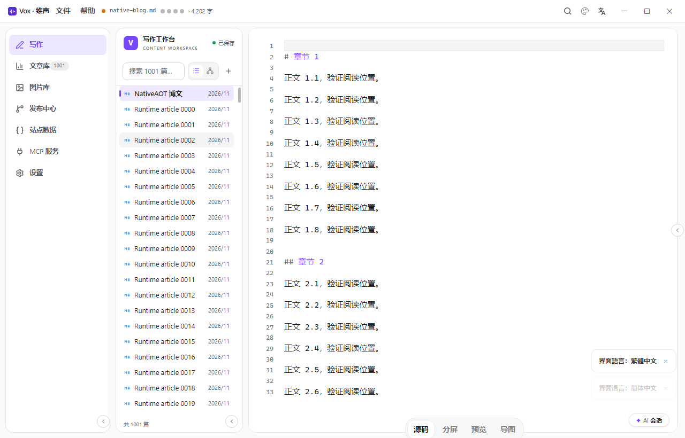

左侧为工作区导航和文章列表，中部提供源码、分屏、预览、思维导图，右侧为大纲与元数据。七个工作区分别是写作、文章库、图片库、发布中心、站点数据、MCP 服务、设置。

文章列表可搜索，在平铺列表与年 / 月树形之间切换。树节点支持左右键折叠与展开；列表和树形共用虚拟化宿主，长列表只实现视口附近的行。

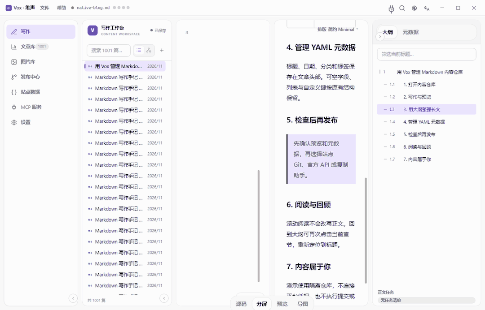

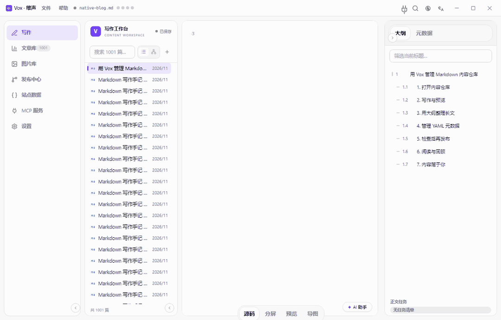

## 3. 大纲与长文阅读

大纲参照 Vex 的行布局：层级角标、章节编号和单行省略标题，保留 Vox 的强调色与主题。列表使用虚拟化宿主，长文不一次创建全部标题行。

点击大纲或按 Enter / Space 定位对应源码行；当前节点可以重复激活。上下键选择不会直接跳文，左右键折叠与展开。标题筛选保留父级上下文，清除筛选后恢复主动折叠状态。阅读预览视口滚动时，当前章节持续高亮，同名标题以源位置区分。跟随只同步状态，不反向跳转或抢正文焦点；用户正在大纲内操作时不主动挪动行。源码模式仍按编辑光标同步。

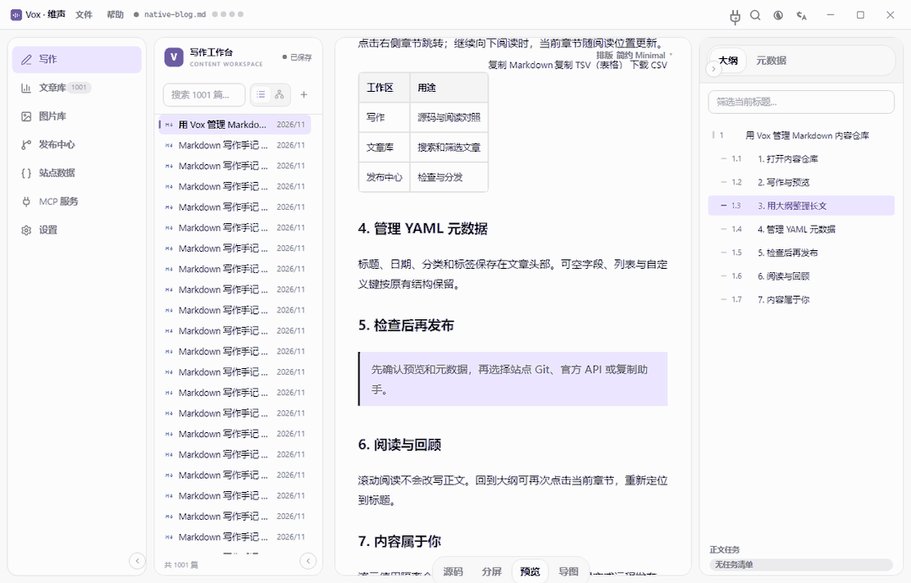

## 4. 博客 YAML 元数据

文章的标题、日期、分类、标签等保存在 Markdown 开头的 YAML front matter；编辑时通过右侧元数据面板维护。可空字段、标量 / 列表与自定义嵌套键由显式节点映射处理，已包含 NativeAOT 往返回归。使用已有博客文章时，先检查预览与字段，再保存，避免把格式校验误认为发布完成。

## 5. 文章、图片与站点数据

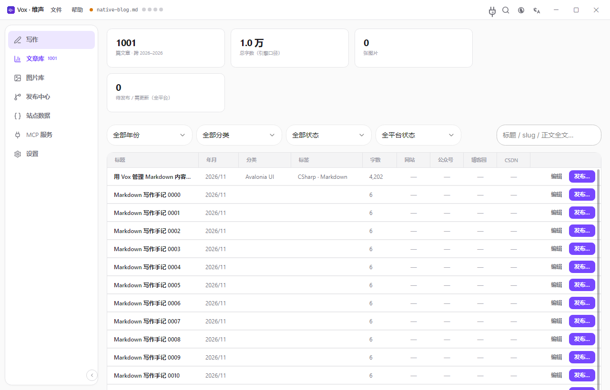

文章库按仓库扫描结果显示文章与筛选状态；图片库用于查看仓库图片及关联信息；站点数据维护内容仓库的 `site/*.json`。具体功能以当前页面可用操作为准。

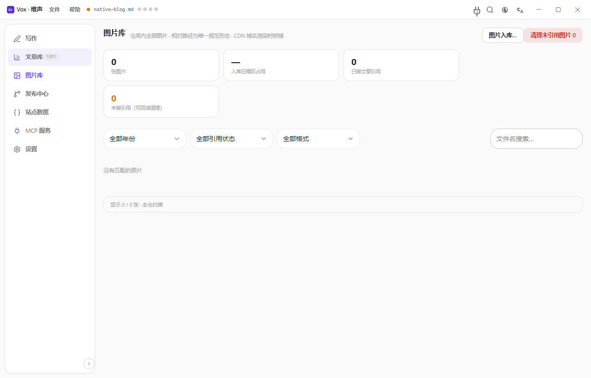

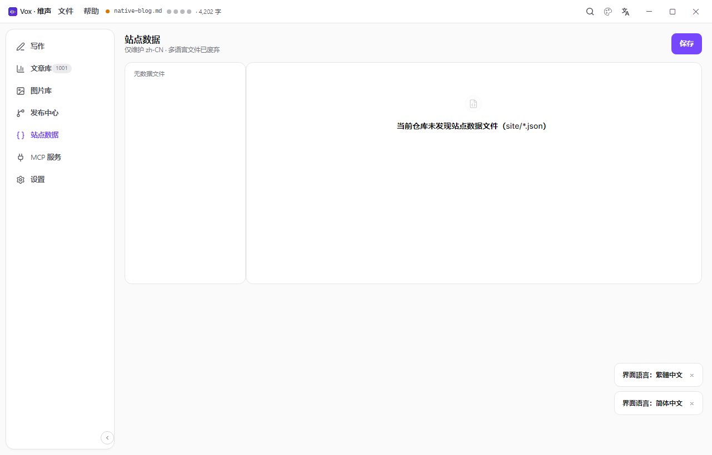

## 6. AI 会话

写作页右下角 ✦ 打开 AI 会话（420 弹层，左缘可拖宽至 640，宽度记忆）。内置通道默认 GLM（BigModel 编码套餐，OpenAI 兼容端点），API Key 存系统凭据管理器。

- **输入区底栏**：左侧自主度模式（仅讨论 / 确认后写入 / 自动插入），右侧模型选择器（服务商分组，GLM 组带思考开关）。
- **引用上下文**：拖选正文浮现「添加到会话」，或格式条 ✦；引用 chip 可点击跳编辑器原文，用户气泡内的引用卡同样可点。
- **流式回复**：推理模型的思考过程在气泡内折叠展示（「已深度思考（用时 N 秒）」，点击展开回看）；回复失败可一键重试，仅讨论模式可重新生成。
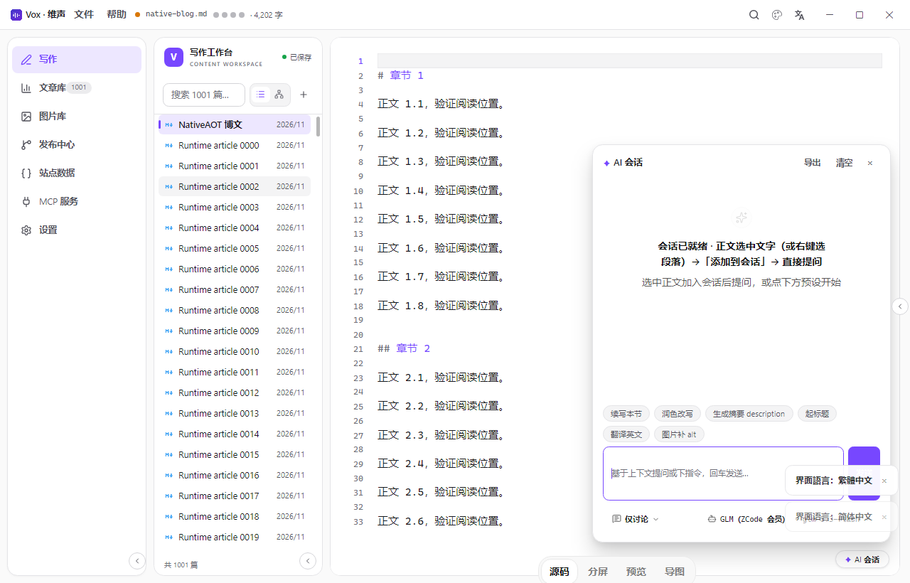

- **应用结果**：自动插入模式回复完成直接落到光标处；改稿预设生成 diff 卡，采纳才改正文并记工具审计；Ctrl+Z 可撤销。会话可导出为 Markdown 归档进仓库。

## 7. 发布中心与自动化

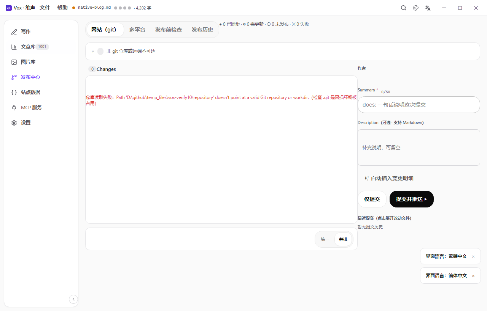

站点 Git、官方平台 API、实验性接口和复制助手有不同能力边界。实验性 CSDN 接口可能受平台变更影响；复制完成也不等于已经在平台发布。检查任务结果和远程文章链接后再确认成功。

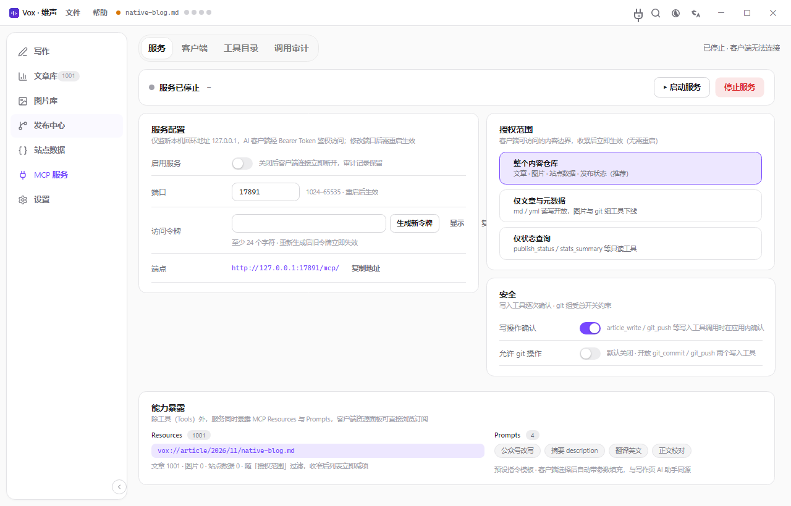

MCP 客户端、工具与审计在本机管理；启用前检查访问范围与写入确认。本文采集未连接真实凭据，未执行 Git 提交、推送或平台发布。

## 8. 外观与设置

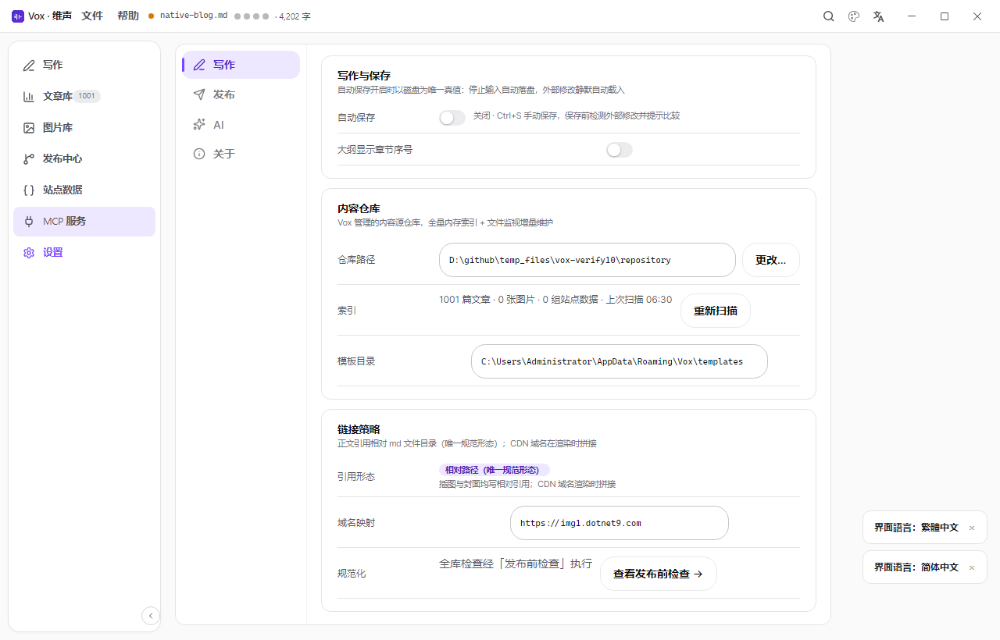

在设置中维护仓库、保存、链接策略、凭据、平台和外观。Arc 管理应用外观，Markdown 渲染复用 CodeWF.Avalonia。应用包含四种界面语言和明暗模式。

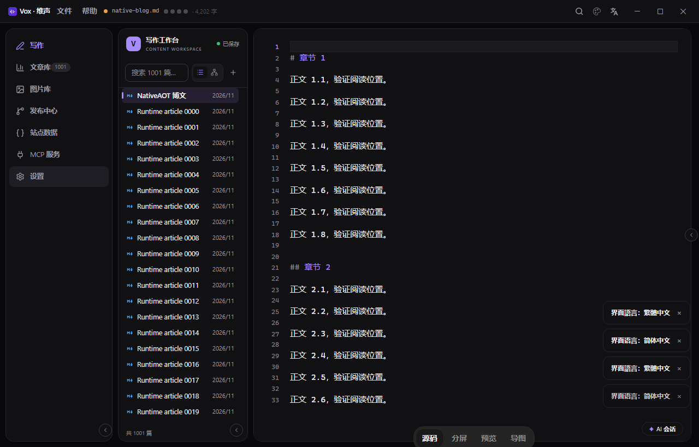

## 9. 媒体采集与验证范围

本组基础为 **七工作区 + AI 会话面板的明暗 PNG**（0.2.0-preview.15 采集）与两张树形 PNG；列表 / 树形、四写作视图、大纲 / 阅读的交互动图沿用同源管线。PNG 为 1280×820；GIF 每段从 60 张连续帧压缩至 1080px 宽，采样间隔约 100ms。素材来自实际 Avalonia 窗口和原生消息循环，不是 HTML 原型或静态图伪造的交互。

使用独立演示仓库、1001 篇文章及无凭据设置。数量是虚拟化测试数据，正文是演示文稿，不能当成用户内容或线上发布结果。框架验证覆盖四语言、七页、明暗主题、YAML / nullable、列表可见性、滚动回收、树键盘与大纲阅读跟随；本机 win-x64 NativeAOT 另行验证通过，不替代其他平台人工验收。

```powershell
$work = 'D:/github/temp_files/vox-docs'
dotnet build src/Vox.App -c Release "-p:ArtifactsPath=$work/artifacts"
dotnet "$work/artifacts/bin/Vox.App/release/Vox.dll" --capture-docs "$work/frames"
python scripts/encode_docs_gif.py "$work/frames/列表与树形" docs/images/runtime-navigation.gif
python scripts/encode_docs_gif.py "$work/frames/写作视图" docs/images/runtime-writing.gif
python scripts/encode_docs_gif.py "$work/frames/大纲与阅读" docs/images/runtime-outline.gif
```

编码脚本需要 Pillow。原始帧写入选定输出目录；只将检查后的最终 PNG / GIF 放入 `docs/images/`。原型旧图保留原文件名，当前应用素材统一采用 `runtime-` 前缀。
