# Vox 软件操作手册（M1 原型版）

对应原型：[design/Vox软件原型.html](../design/Vox软件原型.html)（直接双击打开即可体验，本文截图均取自该原型）。本手册描述 M1 目标交互，是后续 Avalonia 实现的验收基准；界面视觉由 TKCode.Arc 主题正式接管，交互以本文为准。

## 1. 安装与启动

三平台均从 GitHub Releases 下载，安装体验遵循各平台惯例：

| 平台 | 安装方式 | 卸载方式 |
| --- | --- | --- |
| Windows | 品牌安装向导：欢迎 → 许可证 → 位置 → 组件 → 安装 → 完成 | 「设置 → 应用」或开始菜单程序组 → 卸载向导（可选保留用户数据） |
| macOS | 标准 DMG：把 Vox 拖入 Applications | 把 Vox 拖入废纸篓（残留清理命令见卸载页说明） |
| Linux | 软件中心（.deb/.rpm）或命令行 / AppImage | 软件中心「移除」或 `apt/dnf remove` |

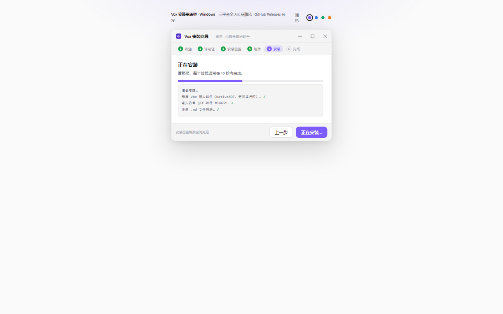

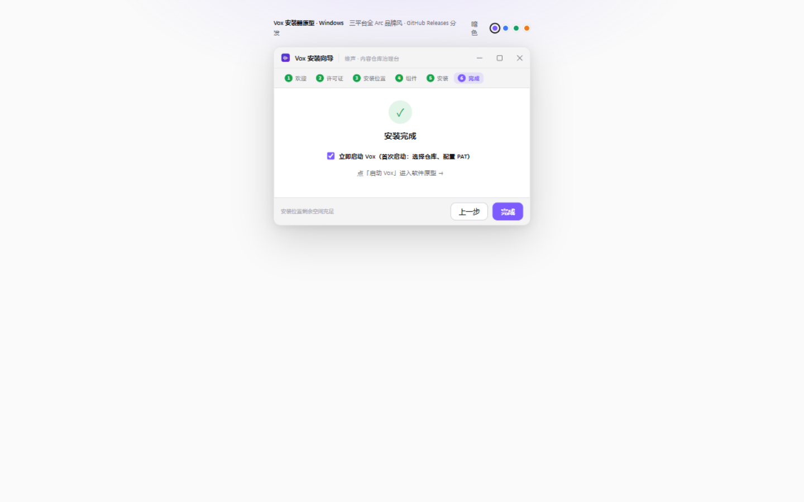

完成页勾选「立即启动 Vox」后，点击右下按钮即进入软件（原型中会打开软件原型页——整条链路是串起来的）。

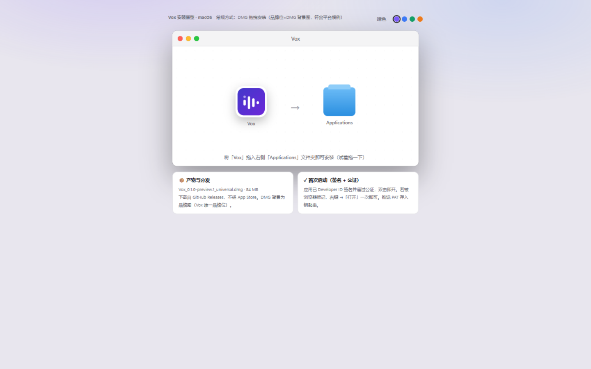

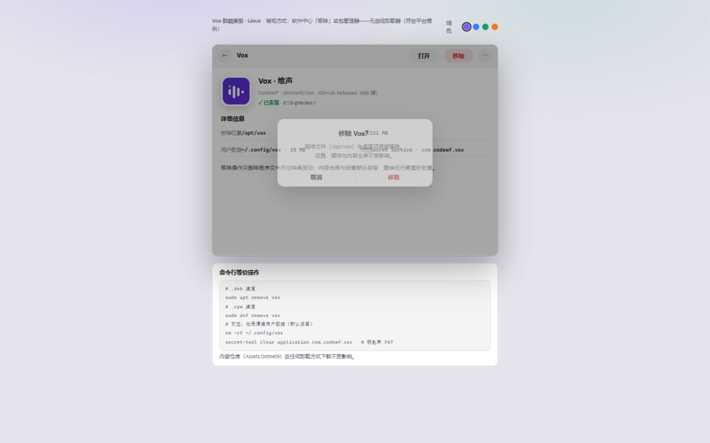

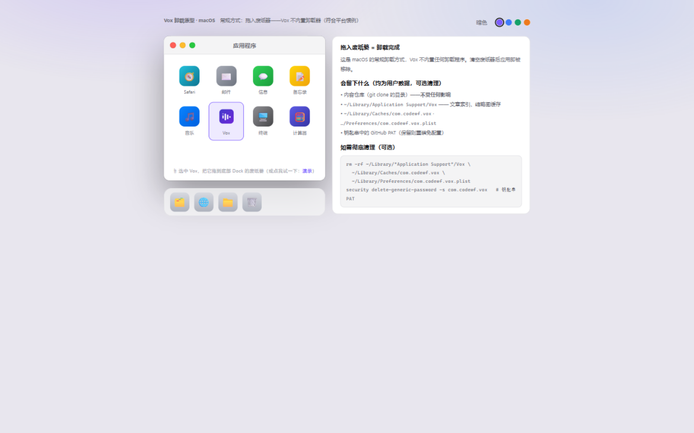

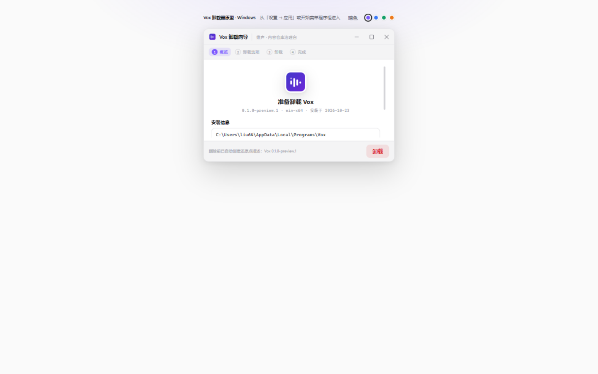

## 2. 主界面总览

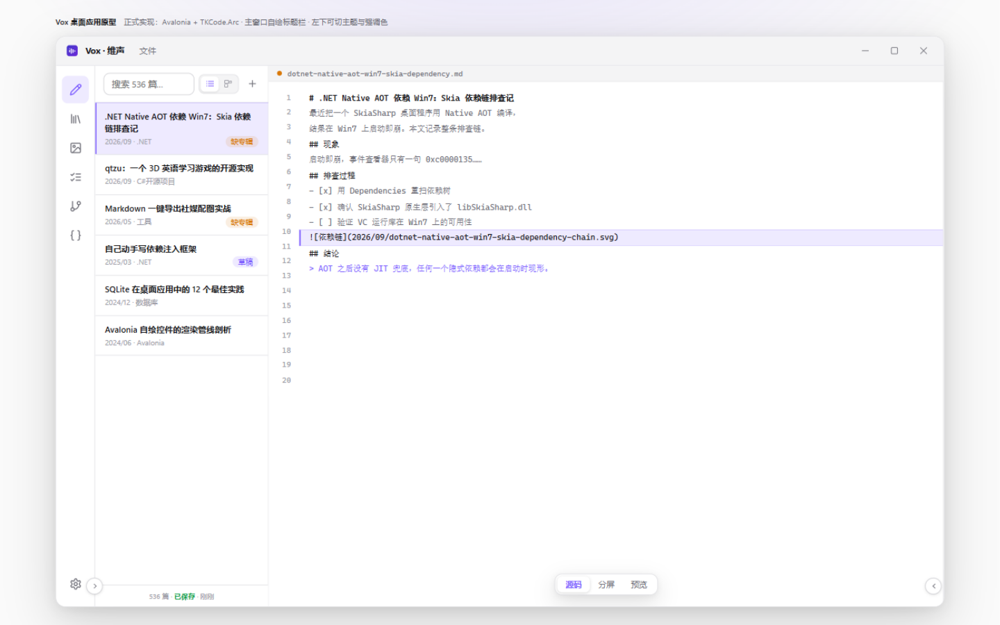

- **标题栏**：左侧为软件 **Logo + 名称「Vox · 维声」+「文件」菜单**（新建文章 / 文章元数据… / 图片入库…）；右侧仅 Windows 式窗口控制钮。不显示视图名、文件名、搜索框与新建按钮——新建入口在文章列表头「＋」，元数据与图片入库经「文件」菜单弹对话框。
- **左边栏**：六个内容视图入口（图标来自 Lucide 体系，正式实现用 `LucideIcon` / `ArcIcons`）；**设置固定在边栏底部**，其下为当前仓库卡片、主题与强调色切换。
- **边栏折叠**：默认收起为纯图标条；折叠钮是**骑在左边框上、与「设置」对齐的圆形小钮**（展开态 ‹ / 折叠态 ›）。
- **内容区默认源码模式**；「源码 / 分屏 / 预览」浮动切换钮**悬于内容区底部居中**；**文件名小栏横跨源码/预览/大纲三区顶部恒定显示**。右侧面板默认收起、只显示**大纲**（无页签头）：折叠钮骑在右分隔线上与左侧同高（收起态钮完全落入工作区）；点击大纲项按常规编辑器逻辑滚动源码到对应行居中。元数据/图片不在面板中——经「文件」菜单对话框操作。
- **国际化**：支持界面语言切换（设置 → 外观 → 语言 / Language），主题、强调色、动效同样收拢在设置内外观段（边栏底部不再放置切换入口）。

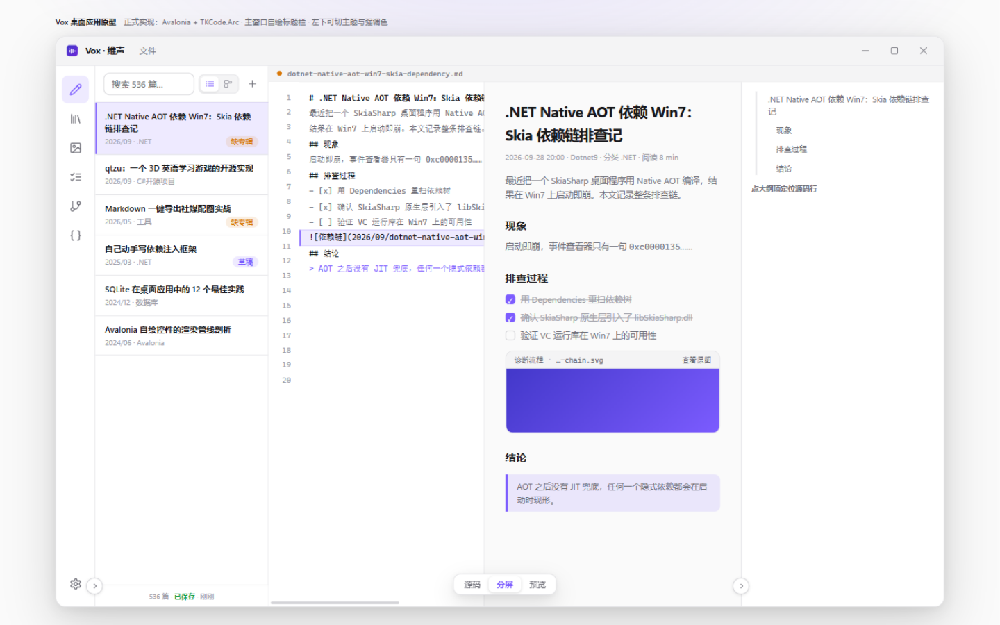

「文件」菜单与元数据对话框：

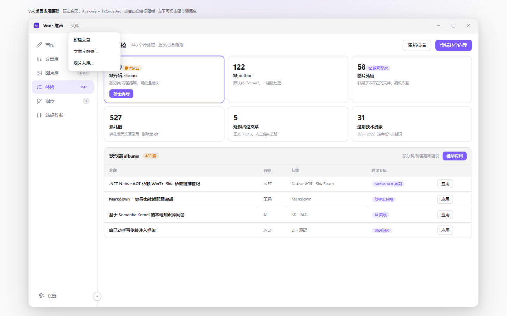

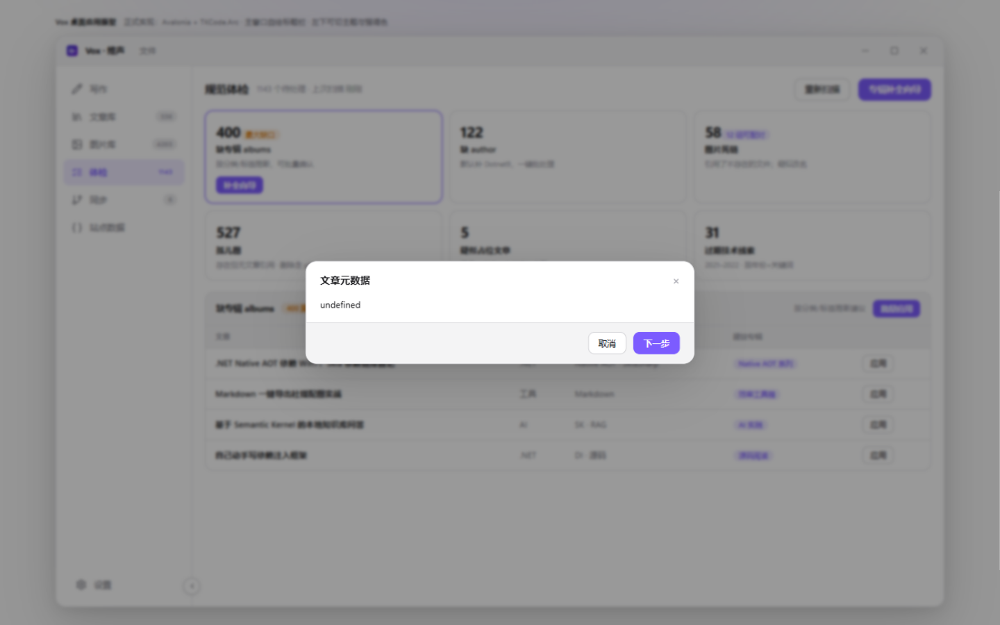

## 3. 写作（默认视图）

三区布局：**文章列表 ｜ 编辑器 / 预览 ｜ 文章面板**，两侧均可在正式实现中收起。

### 3.1 文章列表：列表 / 树形

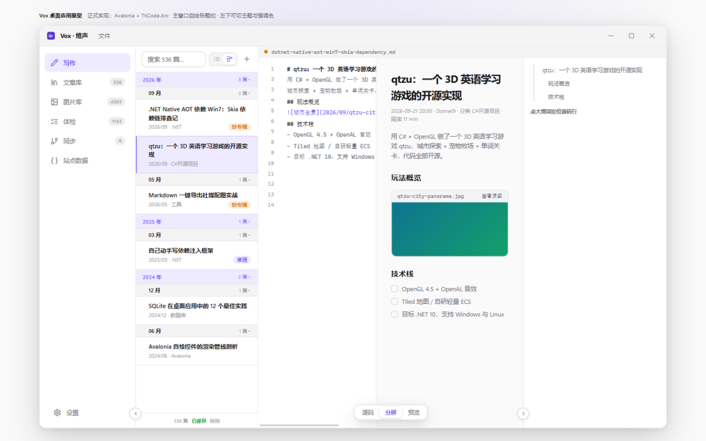

- 列表头右侧：**列表视图**（平铺）↔ **树形视图**（年 → 月 → 文章两层，可折叠）切换 + 「＋」新建按钮。
- **点击任一文章即切换编辑内容**：源码、预览、元数据面板、标题栏文件名全部联动。

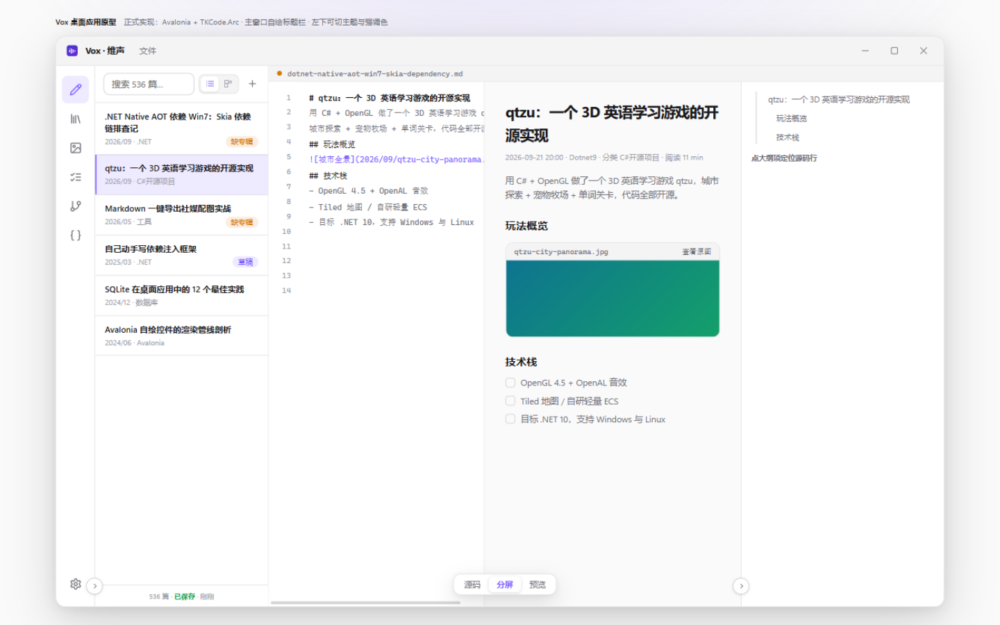

### 3.2 编辑器与预览

- 编辑器带**行号、当前行高亮、文件名小栏**（正式实现 = AvaloniaEdit + TextMate，与预览同源高亮）。
- 「源码 / 分屏 / 预览」三态经内容区底部浮动钮切换；提交推送在「同步」视图操作。
- 预览由 StreamMark 渲染：标题、任务清单、代码块、图片（相对路径本地解析）。

### 3.3 新建文章向导

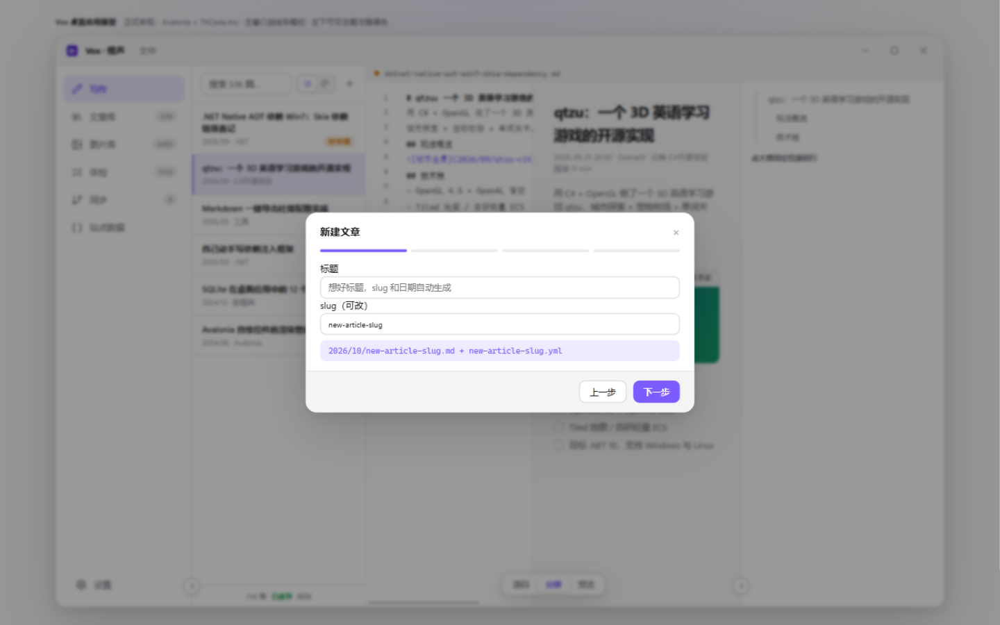

标题 → slug/日期自动生成（可改，实时预览落位路径）→ 简述 → 大纲骨架（生成 md 标题脚手架）→ 确认页展示将创建的 md + yml → 「创建并打开」直接进入写作页。

### 3.4 图片入库

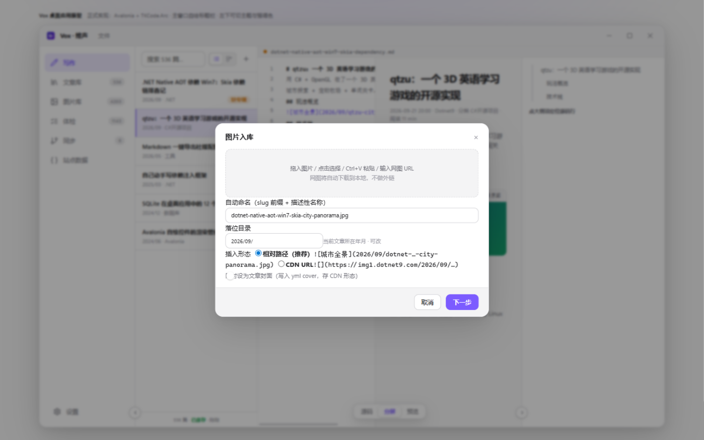

拖入 / 点击选择 / Ctrl+V 粘贴 / 网图 URL 下载四种来源；自动按 slug 前缀命名并落入文章年月目录；插入形态可选**相对路径（推荐）/ CDN URL**；可勾选「同时设为文章封面」（写入 yml cover，存 CDN 形态）。

### 3.5 文章面板

- **元数据**：点封面「更换 / 从正文选」；title/slug/简述/日期表单化编辑；分类/专辑/标签为 chips（专辑缺失显示黄色「缺 · 体检项」警示，点击补全）；作者 + 草稿开关。
- **文章列表**：列表头为搜索 + 列表/树形切换 + 「＋」新建；树形为**年 → 月 → 文章两层结构**（年份行强调色底、箭头在右侧，均可折叠）；列表下方小状态栏（篇数 · 已保存 · 刚刚）。
- **元数据 / 图片**：经「文件」菜单以对话框操作（表单化编辑 yml；图片入库四来源 + 相对/CDN 形态 + 设为封面）。

## 4. 文章库

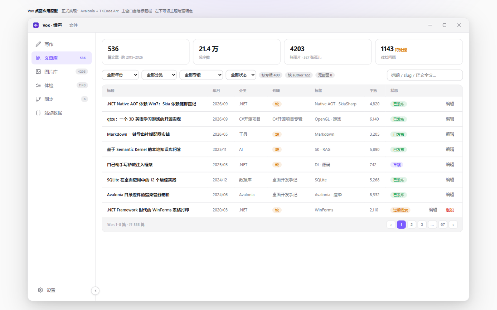

- 顶部统计条：文章数 / 总字数 / 图片数 / 体检问题数。
- 筛选：年份、分类、专辑、状态四个下拉 + 快捷徽标（缺专辑 400、缺 author 122、无封面 0）+ 全文搜索。
- 表格列：标题、年月、分类、专辑（缺则黄色标记）、标签、字数、状态（已发布 / 草稿 / 过期线索）；行尾「编辑」进入写作页，「退役」为治理标记。

## 5. 图片库

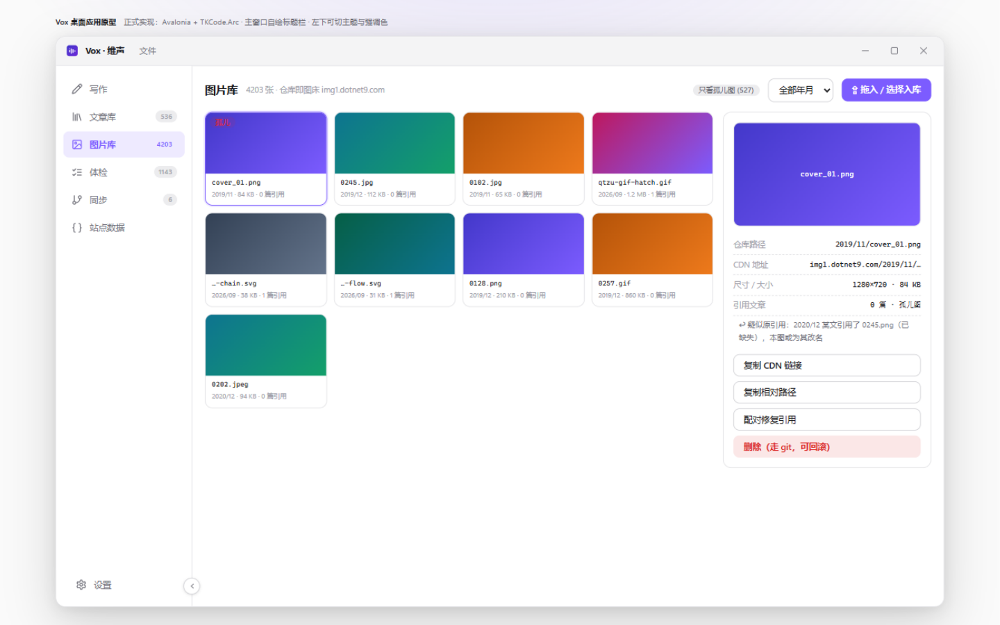

- 缩略图网格（按年月 / 所属文章分组），「只看孤儿图」筛选。
- 右侧详情：仓库路径、CDN 地址、尺寸大小、引用文章数；**配对修复建议**（如 0245.png 死链 ↔ 0245.jpg 孤儿）。
- 操作：复制 CDN 链接 / 复制相对路径 / 配对修复引用 / 删除（走 git，可回滚）。右上「拖入 / 选择入库」与写作页图片入库同一管线。

## 6. 体检

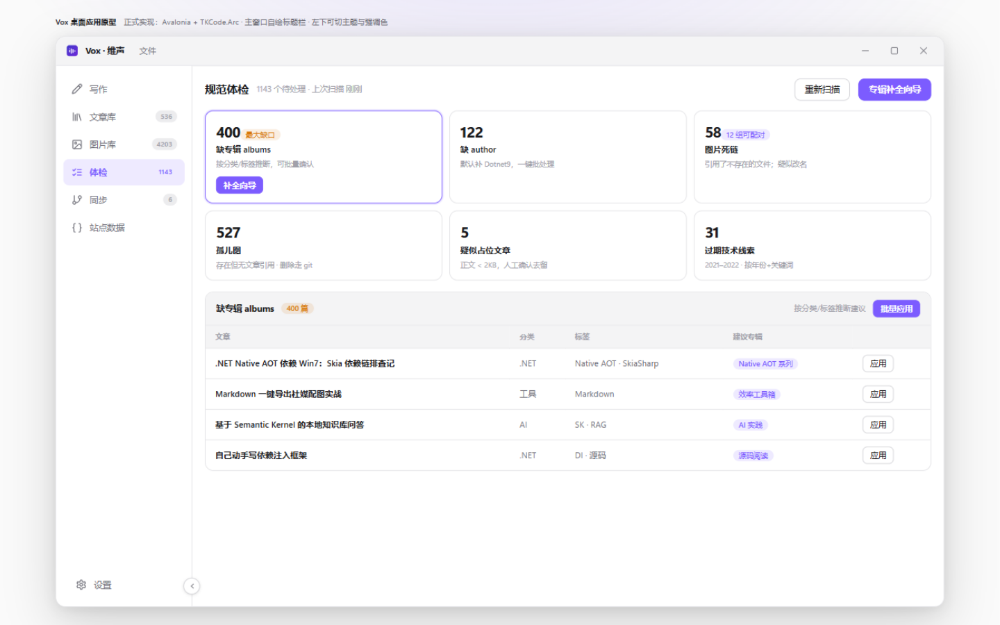

六个问题分组卡（数量取自 2026-10-23 仓库基线）：缺专辑 400、缺 author 122、图片死链 58（12 组可配对）、孤儿图 527、疑似占位 5、过期线索 31。

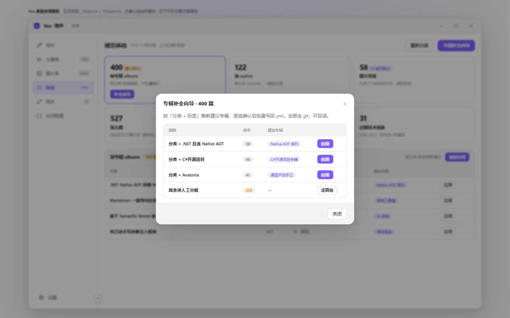

- 「专辑补全向导」：按「分类 + 标签」推断建议专辑，逐规则显示命中数，批量「应用」写回 yml（走 git 可回滚）；其余待人工逐篇分组。
- 治理原则：**系统给线索，人工拍板**；无物理删除。

## 7. 同步

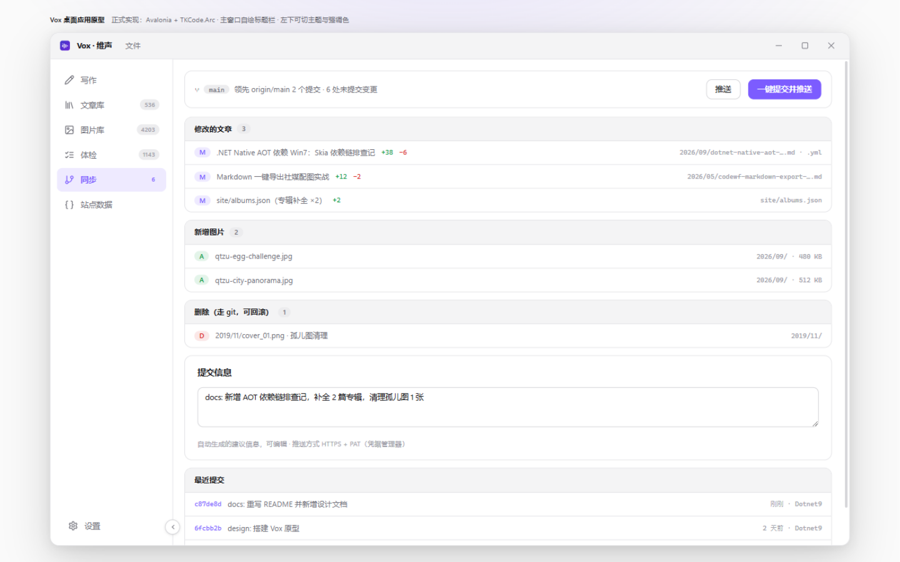

两栏布局（GitHub Desktop 心智模型）：左侧 **Changes 勾选暂存 + diff 预览**，右侧 **Summary / Description 提交面板**。

- **分支条**：main · ↑ 领先 / ↓ 落后徽标 + 「拉取」（ff-only 快进）；「推送 N 个提交」仅在有未推送提交时出现；落后（↓1）时推送被拒绝，须先拉取。原型页顶部工具条提供「远端更新 / 重置」控制评审状态（非应用界面）。
- **Changes 列表**：按语义分组（文章 / 图片 / 站点数据 / 删除·可回滚），组头可折叠并全选；每行**勾选暂存**，支持只提交一部分；行内显示 +/− 行数与路径；全选框在列表头。
- **diff 预览**：点击文件行查看变更；右上角 **并排 / 统一** 两种视图切换（并排 = 左旧右新双栏，统一 = 行内 +绿 −红）；**图片为修改前 → 修改后左右对比**（新增文件一侧显示"无旧版"虚线占位，删除则右侧虚线占位），附尺寸与体积说明。
- **提交面板**：作者身份（可更改）；**Summary** 必填单行，自动生成建议（`docs: 更新 2 篇文章、调整 2 张图片…`），50 字符软上限超限变黄；**Description** 可选多行，「✨ 自动插入变更明细」按勾选项生成 bullet 列表；**仅提交**（离线攒提交）与**提交并推送**（主按钮）双动作。
- **历史**：点击条目展开该次提交的改动文件列表；↗ 在 GitHub 查看提交页。
- 全部提交后进入「一切已同步」空状态（可用页面顶部工具条「重置」恢复演示数据）。

## 8. 站点数据

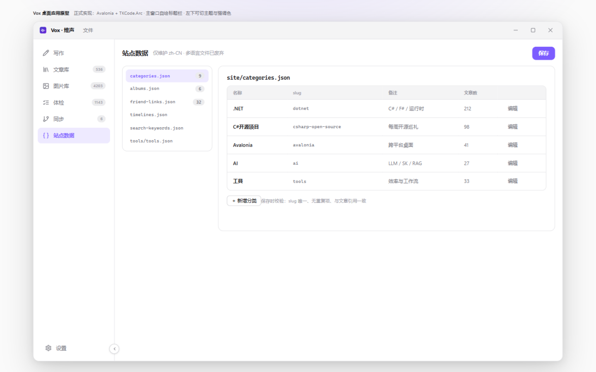

左侧文件列表（categories / albums / friend-links / timelines / search-keywords / tools），右侧表单化表格编辑，仅维护 zh-CN。保存时校验 slug 唯一、无重复项、与文章引用一致；保存即写回 JSON（git 待提交）。

## 9. 设置

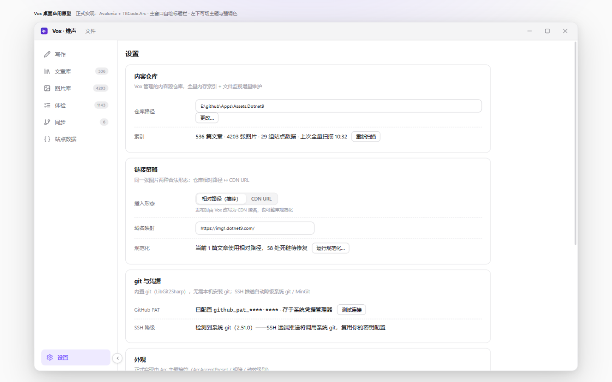

- **内容仓库**：路径选择、重新扫描（全量索引 + 文件监视增量）。
- **链接策略**：插入形态（相对路径推荐 / CDN URL）、域名映射（img1.dotnet9.com）、整库规范化。
- **git 与凭据**：PAT 管理 + 测试连接；SSH 推送自动降级系统 git / MinGit（本机无需安装 git）。
- **外观**：语言 / Language（简体中文 · English）、主题（亮/暗/跟随系统）、四套 Arc 强调色、动效级别。
- **关于**：更新通道 = GitHub Releases，「检查更新」应用内下载替换。

## 10. 快捷键与约定

| 操作 | 入口 |
| --- | --- |
| 全局搜索 | Ctrl K（规划） |
| 新建文章 | 标题栏「＋ 新建文章」 |
| 图片入库 | 写作工具栏「图片入库」/ 图片库「拖入入库」 / 编辑器内 Ctrl V |
| 切换列表/树形 | 文章列表头切换按钮 |

约定：相对路径为编辑期规范形态，发布时改写 CDN；删除永远走 git；草稿不进已发布统计。
